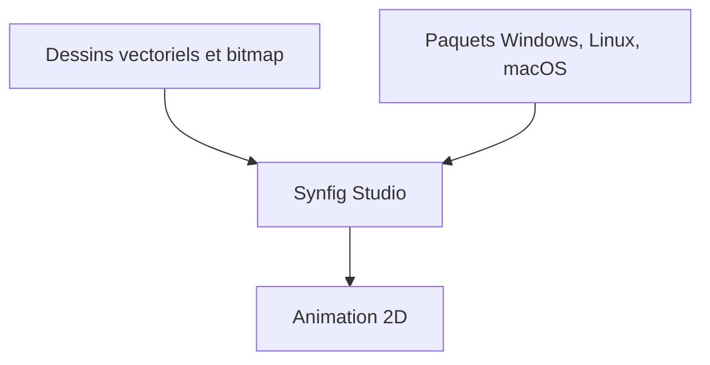

# synfig/synfig

> Free 2D vector and bitmap animation software, for animators on Windows, Linux and macOS.

## The problem
Animating frame by frame takes a lot of people and a lot of time.

## What it actually does
Synfig Studio creates 2D animations from vector and bitmap drawings, avoiding the need to draw every frame. It exists for Windows, Linux and macOS. The README, very short, points to the synfig.org site for installation and building.

## How it is wired
Simplified diagram based on the sheet, no diagram provided.

## Trying it
No command documented in the README: installation points to synfig.org.

## Cost and gotchas
Free (GPL-3.0). Building from source is to be read on the site; the repository has 737 open issues. The README material is insufficient to say more.

## What it is not
It is not a data or AI tool. It is not a video editor: it produces 2D animation.

## Alternatives
No alternative named in the README.

## For you
Ignore: 2D animation software has no connection to data, AI or MLOps work.
