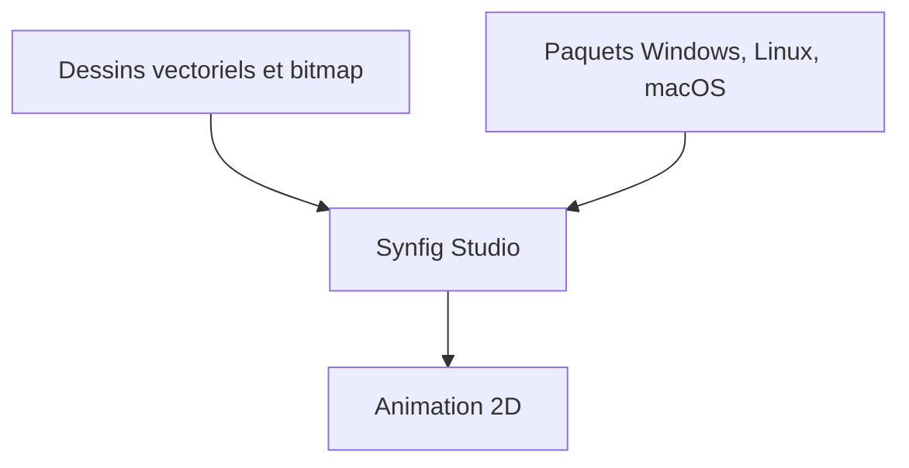

# synfig/synfig

> Logiciel libre d'animation 2D vectorielle et bitmap, pour animateurs sur Windows, Linux et macOS.

## Le problème
Animer image par image demande beaucoup de monde et de temps.

## Ce que ça fait vraiment
Synfig Studio crée des animations 2D à partir de dessins vectoriels et bitmap, en évitant le dessin de chaque image. Il existe pour Windows, Linux et macOS. Le README, très court, renvoie au site synfig.org pour l'installation et la compilation.

## Comment c'est branché
Schéma simplifié d'après la fiche, sans diagramme fourni.

## Essayer
Aucune commande documentée dans le README : l'installation renvoie à synfig.org.

## Coût et pièges
Gratuit (GPL-3.0). La compilation depuis les sources est à lire sur le site ; le dépôt compte 737 issues ouvertes. La matière du README est insuffisante pour en dire plus.

## Ce que ce n'est pas
Ce n'est pas un outil de data ni d'IA. Ce n'est pas un éditeur vidéo : il produit de l'animation 2D.

## Alternatives
Aucune alternative nommée dans le README.

## Pour toi
À ignorer : un logiciel d'animation 2D n'a pas de lien avec un travail data, IA ou MLOps.

