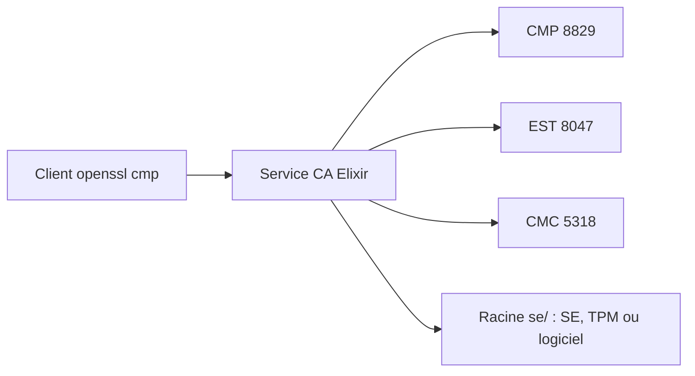

# synrc/ca

> Certificate authority written in Elixir, with CMP, EST and CMC protocols and keys in TPM or Secure Enclave.

## The problem
Issuing and managing X.509 certificates with a hardware-protected root.

## What it actually does
An Elixir service that issues certificates via CMP (TCP 8829), EST (HTTP 8047) and CMC (TCP 5318). The root key is stored in the Secure Enclave (macOS), a TPM 2.0 (Linux) or an encrypted file. Two separate roles: Admin and Security Admin, with NIST SP 800-53 compliance profiles.

## How it is wired
Simplified diagram based on the sheet, no diagram provided.


## Trying it
```bash
git clone https://github.com/synrc/ca
cd ca
mix deps.get
mix compile
mix run --no-halt
```

## Cost and gotchas
Requires Erlang/OTP 25 to 28 and Elixir 1.17 to 19 (outside the list), `libtss2-dev` on Linux for the TPM. Losing the hardware key forces reissuing everything. Demo passwords in the examples.

## What it is not
Not a production-ready service without an audit: security-sensitive, single main maintainer.

## Alternatives
None named in the README.

## For you
Ignore: niche PKI infrastructure in Elixir, outside the usual needs of a data/AI/MLOps profile.
