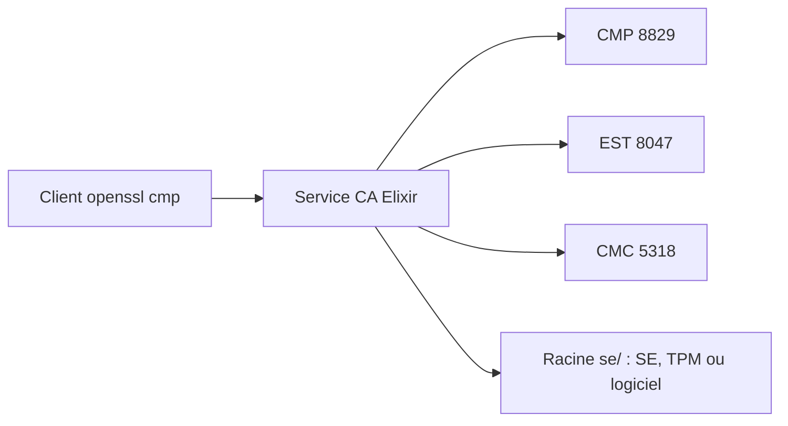

# synrc/ca

> Autorité de certification écrite en Elixir, avec protocoles CMP, EST et CMC et clés dans TPM ou Secure Enclave.

## Le problème
Émettre et gérer des certificats X.509 avec une racine protégée par le matériel.

## Ce que ça fait vraiment
Un service Elixir qui émet des certificats via CMP (TCP 8829), EST (HTTP 8047) et CMC (TCP 5318). La clé racine est stockée dans le Secure Enclave (macOS), un TPM 2.0 (Linux) ou un fichier chiffré. Deux rôles séparés : Admin et Security Admin, avec des profils de conformité NIST SP 800-53.

## Comment c'est branché
Schéma simplifié d'après la fiche, sans diagramme fourni.


## Essayer
```bash
git clone https://github.com/synrc/ca
cd ca
mix deps.get
mix compile
mix run --no-halt
```

## Coût et pièges
Erlang/OTP 25 à 28 et Elixir 1.17 à 19 requis (hors liste), `libtss2-dev` sur Linux pour le TPM. Perdre la clé matérielle impose de tout réémettre. Mots de passe de démonstration dans les exemples.

## Ce que ce n'est pas
Pas un service prêt pour la production sans audit : sécurité sensible, mainteneur principal unique.

## Alternatives
Aucune nommée dans le README.

## Pour toi
À ignorer : infrastructure PKI de niche en Elixir, hors des besoins courants d'un profil data/IA/MLOps.

