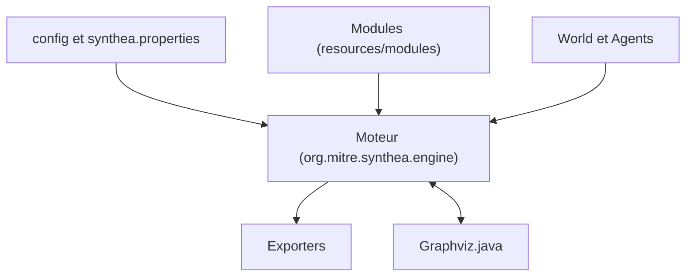

# synthetichealth/synthea

> Synthetic patient simulator that produces realistic health records in FHIR, C-CDA or CSV.

## The problem
Real health data is protected and hard to obtain for testing tools or training models.

## What it actually does
Simulates whole lives (birth to death) with JSON rule modules and custom Java rules, on demographic data (Massachusetts by default). Exports FHIR (R4, STU3, DSTU2), FHIR bulk ndjson, C-CDA, CSV, CPCDS. Renders the modules with Graphviz.

## How it is wired


## Trying it
```bash
git clone https://github.com/synthetichealth/synthea.git
cd synthea
./gradlew build check test
./run_synthea -p 1000 Massachusetts
```

## Cost and gotchas
Free. Requires a JDK 17 or later (17 or 25 recommended), not covered by the prerequisites list. CSV, C-CDA and FHIR bulk exports are disabled by default.

## What it is not
Not a generator of real data nor proof of clinical realism: the data is synthetic. Not a hosted service either.

## Alternatives
No alternative cited in the README.

## For you
Adopt: a source of FHIR or CSV patient records to prototype a health pipeline or model without touching real data.
