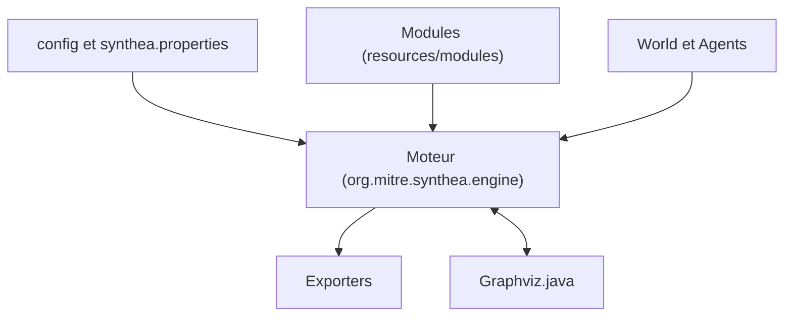

# synthetichealth/synthea

> Simulateur de patients synthétiques qui produit des dossiers de santé réalistes en FHIR, C-CDA ou CSV.

## Le problème
Les données de santé réelles sont protégées et difficiles à obtenir pour tester des outils ou entraîner des modèles.

## Ce que ça fait vraiment
Simule des vies complètes (naissance à décès) avec des modules de règles JSON et des règles Java personnalisées, sur des données démographiques (Massachusetts par défaut). Exporte FHIR (R4, STU3, DSTU2), FHIR bulk ndjson, C-CDA, CSV, CPCDS. Rend les modules avec Graphviz.

## Comment c'est branché


## Essayer
```bash
git clone https://github.com/synthetichealth/synthea.git
cd synthea
./gradlew build check test
./run_synthea -p 1000 Massachusetts
```

## Coût et pièges
Gratuit. Demande un JDK 17 ou plus (17 ou 25 conseillés), non couvert par la liste des prérequis. Les exports CSV, C-CDA et bulk FHIR sont désactivés par défaut.

## Ce que ce n'est pas
Pas un générateur de données réelles ni une preuve de réalisme clinique : les données sont synthétiques. Ni un service hébergé.

## Alternatives
Aucune alternative citée dans le README.

## Pour toi
Adopter : source de dossiers patients FHIR ou CSV pour prototyper un pipeline ou un modèle de santé sans toucher de données réelles.

