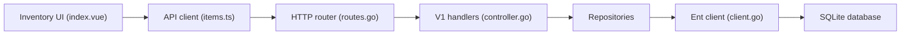

# sysadminsmedia/homebox

> Self-hosted home inventory application, with locations, labels, attachments and tracking.

## The problem
Knowing where things in the house are, along with their warranties and maintenance.

## What it actually does
Organization by categories, locations and tags, custom fields, search, photos, documents and warranties, purchase and maintenance, export, label generation. Go with SQLite and an embedded web interface; versioned API, authentication including OIDC (according to the diagram).

## How it is wired


## Trying it
```bash
openssl rand -base64 48 > hbox.pepper
chmod 400 hbox.pepper
docker run -d --name homebox --restart unless-stopped --publish 3100:7745 \
  --env HBOX_AUTH_API_KEY_PEPPER=$(cat hbox.pepper) \
  --volume /path/to/data/folder/:/data ghcr.io/sysadminsmedia/homebox:latest
```

## Cost and gotchas
Free. The data folder must be owned by UID 65532 for the rootless and hardened images. AGPL-3.0.

## What it is not
Not an enterprise inventory tool. Memory "under 50 MB at idle": a claim from the README.

## Alternatives
None named; project derived from the original by hay-kot.

## For you
Ignore for professional watch: a useful homelab app, but unrelated to data/AI/MLOps.
