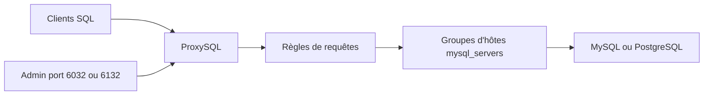

# sysown/proxysql

> MySQL and PostgreSQL proxy that routes, caches and balances queries across database servers.

## The problem
An application connected directly to several database servers has to handle read/write routing and high availability itself.

## What it actually does
ProxySQL sits between clients and MySQL (Percona, MariaDB) or PostgreSQL servers. It is configured in SQL through an admin interface (ports 6032 and 6132): servers, users, query rules routed by regular expression to host groups, cache, access control. A config file is used only for bootstrapping.

## How it is wired
Simplified diagram based on the sheet, no diagram provided.


## Trying it
```bash
wget https://github.com/sysown/proxysql/releases/download/v3.0.4/proxysql_3.0.4-ubuntu24_amd64.deb
dpkg -i proxysql_3.0.4-ubuntu24_amd64.deb
service proxysql start
mysql -u admin -padmin -h 127.0.0.1 -P6032 --prompt='Admin> '
```

## Cost and gotchas
Free, GPL-3.0. Default admin credentials (`admin`/`admin`) must be changed. After the first start, the internal database is the source of truth, not the config file.

## What it is not
Not a database nor an AI tool. The copyleft license imposes its conditions if you embed or distribute the code.

## Alternatives
No alternative named in the README.

## For you
Ignore on the data / AI side: it is transactional database infrastructure, mostly useful to teams operating MySQL clusters.
