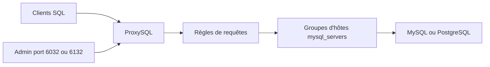

# sysown/proxysql

> Proxy MySQL et PostgreSQL qui route, met en cache et répartit les requêtes entre serveurs de bases.

## Le problème
Une application branchée en direct sur plusieurs serveurs de base de données doit gérer elle-même le routage lecture/écriture et la haute disponibilité.

## Ce que ça fait vraiment
ProxySQL se place entre les clients et les serveurs MySQL (Percona, MariaDB) ou PostgreSQL. On le configure en SQL par une interface d'administration (ports 6032 et 6132) : serveurs, utilisateurs, règles de requêtes routées par expression régulière vers des groupes d'hôtes, cache, contrôle d'accès. Un fichier de config sert seulement à l'amorçage.

## Comment c'est branché
Schéma simplifié d'après la fiche, sans diagramme fourni.


## Essayer
```bash
wget https://github.com/sysown/proxysql/releases/download/v3.0.4/proxysql_3.0.4-ubuntu24_amd64.deb
dpkg -i proxysql_3.0.4-ubuntu24_amd64.deb
service proxysql start
mysql -u admin -padmin -h 127.0.0.1 -P6032 --prompt='Admin> '
```

## Coût et pièges
Gratuit, GPL-3.0. Identifiants admin par défaut (`admin`/`admin`) à changer. Après le premier démarrage, c'est la base interne qui fait foi, pas le fichier de config.

## Ce que ce n'est pas
Pas une base de données ni un outil d'IA. La licence copyleft impose ses conditions si tu intègres ou distribues le code.

## Alternatives
Aucune alternative nommée dans le README.

## Pour toi
À ignorer côté data / IA : c'est de l'infrastructure de bases transactionnelles, utile surtout aux équipes qui exploitent des grappes MySQL.

