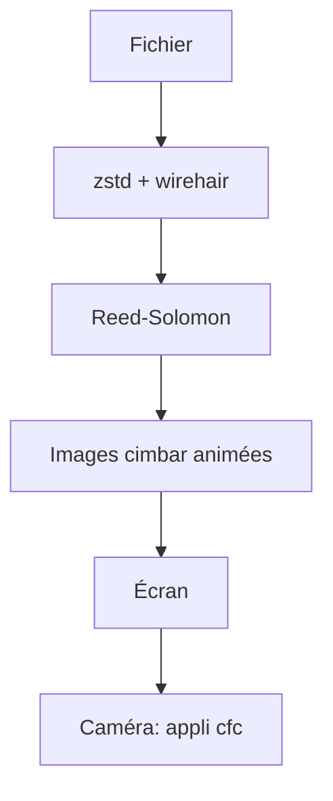

# sz3/libcimbar

> Experimental animated barcode format for transferring files without a network, from screen to phone camera.

## The problem
Transferring data between network-isolated machines, with no Internet, Bluetooth or NFC.

## What it actually does
Encodes a file as a series of images of colored tiles, with Reed-Solomon error correction, fountain codes (wirehair) and zstd compression. Claims about 850 kbit/s with a screen and a phone camera. The decoder is a separate Android app (sz3/cfc). The encoder also runs in the browser via WASM on cimbar.org.

## How it is wired
Simplified diagram based on the sheet, no diagram provided.



## Trying it
```bash
sudo apt install libopencv-dev libglfw3-dev libgles2-mesa-dev
cmake .
make -j7
./cimbar --encode -i inputfile.txt -o outputprefix
./cimbar outputprefix*.png -o /tmp
./cimbar_send inputfile.pdf
```

## Cost and gotchas
Free. Requires OpenCV and GLFW to build. Files up to 33 MB after compression. Windows supported on a best-effort basis. A large file can fill the disk with PNGs.

## What it is not
Not a proven transfer solution: the README calls it an experimental format. Decoding requires the Android app, which is outside this repository.

## Alternatives
- txqr: inspiration cited in the README.

## For you
Watch: technical curiosity for isolated environments, not a common data pipeline tool.
