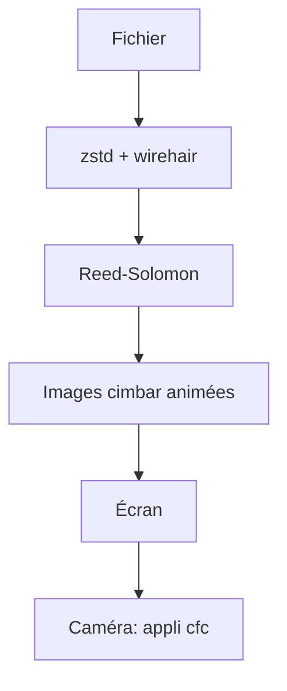

# sz3/libcimbar

> Format de code-barres animé expérimental pour transférer des fichiers sans réseau, écran vers caméra de téléphone.

## Le problème
Transférer des données entre machines isolées du réseau, sans Internet, Bluetooth ni NFC.

## Ce que ça fait vraiment
Encode un fichier en une série d'images de tuiles colorées, avec correction d'erreur Reed-Solomon, codes fontaine (wirehair) et compression zstd. Annonce environ 850 kbit/s avec un écran et une caméra de téléphone. Le décodeur est une appli Android séparée (sz3/cfc). L'encodeur tourne aussi dans le navigateur via WASM sur cimbar.org.

## Comment c'est branché
Schéma simplifié d'après la fiche, sans diagramme fourni.



## Essayer
```bash
sudo apt install libopencv-dev libglfw3-dev libgles2-mesa-dev
cmake .
make -j7
./cimbar --encode -i inputfile.txt -o outputprefix
./cimbar outputprefix*.png -o /tmp
./cimbar_send inputfile.pdf
```

## Coût et pièges
Gratuit. Exige OpenCV et GLFW pour compiler. Fichiers jusqu'à 33 Mo après compression. Windows pris en charge au mieux. Un gros fichier peut remplir le disque de PNG.

## Ce que ce n'est pas
Pas une solution de transfert éprouvée : le README parle de format expérimental. Le décodage nécessite l'appli Android, hors de ce dépôt.

## Alternatives
- txqr : inspiration citée dans le README.

## Pour toi
À surveiller : curiosité technique pour environnements isolés, pas un outil de pipeline data courant.

