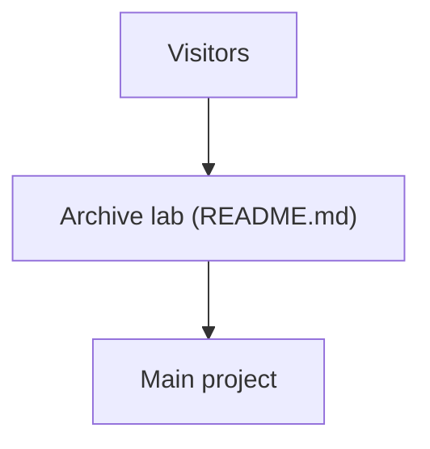

# t41372/Open-LLM-VTuber

> Personal archive fork that points to the real Open-LLM-VTuber project, with no content of its own.

## The problem
Old links point here after a GitHub redirect broke, and visitors land on the wrong repository.

## What it actually does
Nothing functional: the README explains the history (transfer to the organization, new archive fork) and redirects to Open-LLM-VTuber/Open-LLM-VTuber. The repository is used to archive branches and experiments; only the README is provided.

## How it is wired

## Trying it
No command documented: go to Open-LLM-VTuber/Open-LLM-VTuber.

## Cost and gotchas
None. Gotcha: cloning here gives you an archive of experiments, not the product.

## What it is not
Not the Open-LLM-VTuber project itself. No license declared. Last push on 2026-02-14.

## Alternatives
Open-LLM-VTuber/Open-LLM-VTuber, the main repository cited by the README.

## For you
Ignore: a mere redirect sign; go straight to the main repository.
