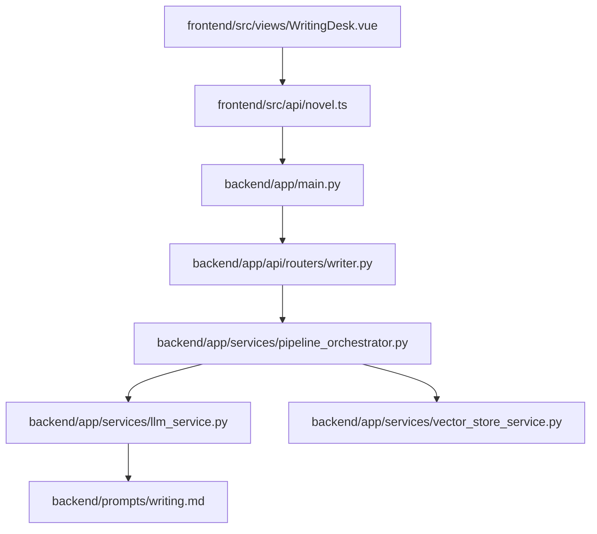

# t59688/arboris-novel

> Web application for writing novels with an LLM: character sheets, outline and multiple versions.

## The problem
Authors lose track of their world (characters, places, rules) and get stuck on the next chapter.

## What it actually does
The Vue writing desk calls FastAPI routers. An orchestrator uses llm_service with Markdown prompts and a vector store to propose an outline, chapters and several versions to compare. Novels are stored in SQLite (default) or MySQL. Compatible with any OpenAI-compatible API.

## How it is wired


## Trying it
```bash
cp .env.example .env
docker compose up -d
```
The `.env` must set SECRET_KEY, OPENAI_API_KEY and ADMIN_DEFAULT_PASSWORD.

## Cost and gotchas
LLM API key at your expense, default model gpt-3.5-turbo. No declared license: reuse is uncertain. The README warns of frequent JSON errors with weak models.

## What it is not
Not an autonomous novel generator: the author stays in the driver's seat. No clear support outside Chinese.

## Alternatives
novel-kit is cited for command-line use with an editor.

## For you
Worth watching: a clean example of a FastAPI, Vue and LLM pipeline with a vector store, but unlicensed and focused on writing.
