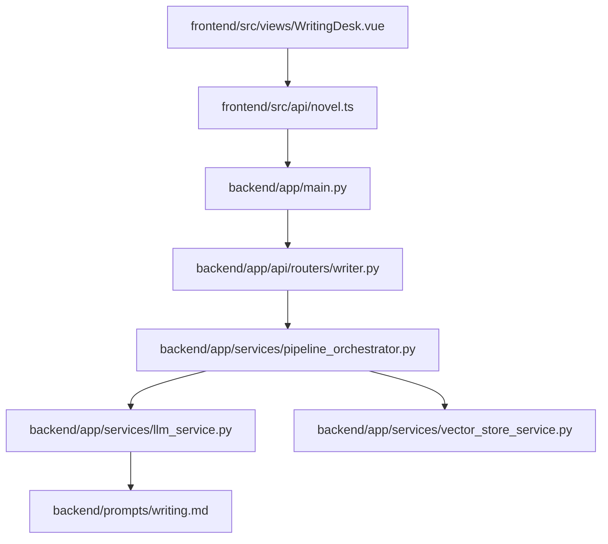

# t59688/arboris-novel

> Application web d'aide à l'écriture de romans avec un LLM : fiches de personnages, plan et versions multiples.

## Le problème
Les auteurs perdent le fil de leur univers (personnages, lieux, règles) et butent sur le prochain chapitre.

## Ce que ça fait vraiment
Le bureau d'écriture Vue appelle des routeurs FastAPI. Un orchestrateur utilise llm_service avec des prompts Markdown et un magasin vectoriel pour proposer un plan, des chapitres et plusieurs versions à comparer. Les romans sont stockés en SQLite (par défaut) ou MySQL. Compatible avec toute API OpenAI-compatible.

## Comment c'est branché


## Essayer
```bash
cp .env.example .env
docker compose up -d
```
Le `.env` doit renseigner SECRET_KEY, OPENAI_API_KEY et ADMIN_DEFAULT_PASSWORD.

## Coût et pièges
Clé d'API LLM à ta charge, modèle par défaut gpt-3.5-turbo. Aucune licence déclarée : réutilisation incertaine. Le README signale des erreurs fréquentes de JSON avec les modèles faibles.

## Ce que ce n'est pas
Pas un générateur de romans autonome : l'auteur reste pilote. Pas de support clair en dehors du chinois.

## Alternatives
novel-kit est cité pour un usage en ligne de commande avec un éditeur.

## Pour toi
À surveiller : exemple propre de pipeline FastAPI, Vue et LLM avec magasin vectoriel, mais sans licence et centré sur l'écriture.

