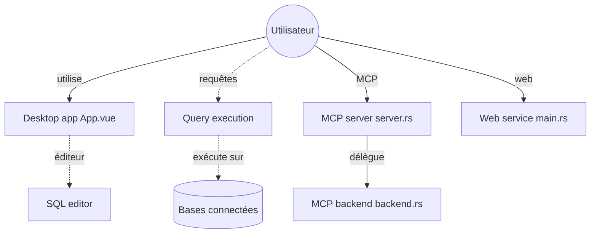

# t8y2/dbx

> Lightweight database client (desktop, Docker, web) with an AI assistant and an MCP server.

## The problem
Database clients are heavy, proprietary or limited to one engine type, and poorly integrated with coding agents.

## What it actually does
A Tauri 2 application (Rust, Vue 3) of about 25 MB, without Chromium, that connects to more than 100 engines: MySQL, PostgreSQL, Redis, MongoDB, DuckDB, ClickHouse, vector databases, message queues. SQL editor, data grid, ER diagram, schema comparison, import/export. An AI assistant writes and explains SQL. A separate MCP server and CLI let agents query databases with read-only or write modes.

## How it is wired


## Trying it
```bash
brew install --cask dbx
npx @dbx-app/mcp-server
docker run -d --pull=always --name dbx -p 4224:4224 \
  -v dbx-data:/app/data \
  t8y2/dbx:latest
```

## Cost and gotchas
Free. The credential encryption key is located in the data folder and must be backed up along with the database. The MCP server is distributed separately; allow writing with caution. Project started in April 2026, 1,375 open issues.

## What it is not
Not a BI tool nor a data warehouse. The agent drivers (JDBC) require Java.

## Alternatives
DBeaver and Navicat, whose connection profiles DBX can import.

## For you
Worth watching as an SQL and MCP client for your databases; the tool is young and maintained by one person, but lightweight and very broad.
