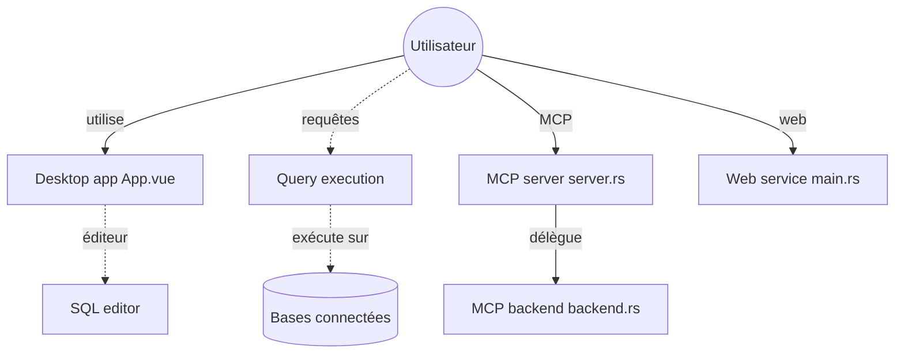

# t8y2/dbx

> Client de bases de données léger (bureau, Docker, web) avec assistant IA et serveur MCP.

## Le problème
Les clients de bases sont lourds, propriétaires ou limités à un type de moteur, et peu intégrés aux agents de code.

## Ce que ça fait vraiment
Une application Tauri 2 (Rust, Vue 3) d'environ 25 Mo, sans Chromium, qui se connecte à plus de 100 moteurs : MySQL, PostgreSQL, Redis, MongoDB, DuckDB, ClickHouse, bases vectorielles, files de messages. Éditeur SQL, grille de données, diagramme ER, comparaison de schémas, import/export. Un assistant IA écrit et explique le SQL. Un serveur MCP et une CLI séparés permettent aux agents d'interroger les bases avec des modes lecture seule ou écriture.

## Comment c'est branché


## Essayer
```bash
brew install --cask dbx
npx @dbx-app/mcp-server
docker run -d --pull=always --name dbx -p 4224:4224 \
  -v dbx-data:/app/data \
  t8y2/dbx:latest
```

## Coût et pièges
Gratuit. La clé de chiffrement des identifiants se trouve dans le dossier de données et doit être sauvegardée avec la base. Le serveur MCP est distribué à part ; autorise l'écriture avec prudence. Projet né en avril 2026, 1 375 issues ouvertes.

## Ce que ce n'est pas
Ce n'est pas un outil de BI ni un entrepôt de données. Les pilotes agents (JDBC) demandent Java.

## Alternatives
DBeaver et Navicat, dont DBX sait importer les profils de connexion.

## Pour toi
À surveiller comme client SQL et MCP pour tes bases ; l'outil est jeune et tenu par une personne, mais léger et très large.

