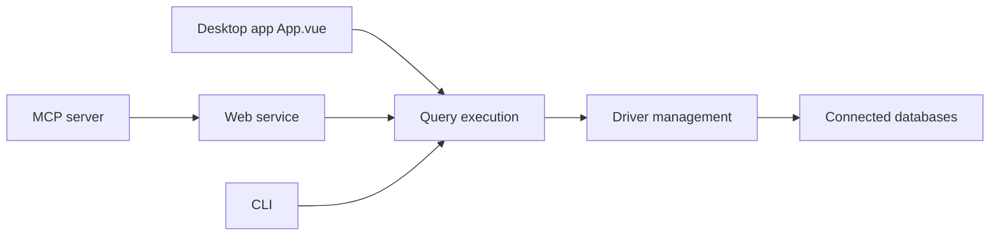

# t8y2/dbx

> Client de bases de données Tauri de 25 Mo, avec assistant SQL IA, serveur MCP, CLI et version Docker.

## Le problème
Gérer MySQL, PostgreSQL, Redis, MongoDB et autres demande plusieurs clients lourds, rarement utilisables par un agent.

## Ce que ça fait vraiment
Client multi-bases (100+ moteurs annoncés) : éditeur SQL CodeMirror, grille de données éditable, navigateur de schéma, diagramme ER, comparaison de schémas, import/export, tunnel SSH. Assistant SQL IA (Claude, OpenAI, modèles locaux). Serveur MCP séparé et CLI `dbx` avec modes lecture seule, lecture/écriture ou accès complet. Système de plugins signés et sandboxés. Identifiants chiffrés localement.

## Comment c'est branché


## Essayer
```bash
brew install --cask dbx
docker run -d --pull=always --name dbx -p 4224:4224 -v dbx-data:/app/data t8y2/dbx:latest
npx @dbx-app/mcp-server
npm install -g @dbx-app/cli
```

## Coût et pièges
Gratuit ; l'IA utilise ta clé ou un modèle local. Sauvegarder `dbx.db` avec `secret.key` ; clé non portable entre machines hors export chiffré. Le mode MCP en écriture expose tes bases à l'agent : régler la politique. 1 375 issues ouvertes.

## Ce que ce n'est pas
Pas un outil de supervision ni d'orchestration de données. Le nombre de moteurs pris en charge est celui du README, avec des niveaux de maturité variables selon les pilotes.

## Alternatives
DBeaver, Navicat et DataGrip (le README importe les profils des deux premiers et imite les filtres du troisième).

## Pour toi
À surveiller : intéressant pour interroger des bases depuis un agent via MCP en lecture seule ; le projet est jeune (créé en 2026) et porté par une personne, donc pas encore à adopter.

