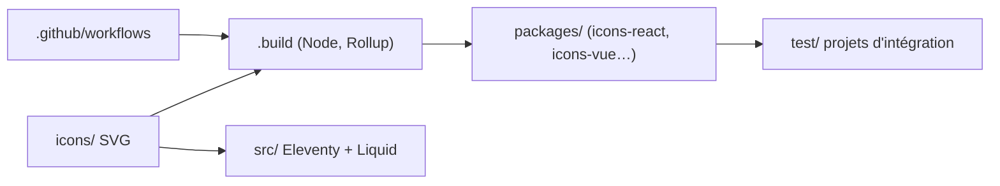

# tabler/tabler-icons

> Set of 6,202 MIT-licensed SVG icons, distributed as per-framework packages, for web interfaces.

## The problem
Finding consistent icons (24x24 grid, 2 px stroke) in every format: raw SVG, sprite, font, React, Vue, Svelte or Angular components.

## What it actually does
An icon repository (5,148 outline, 1,054 filled) and npm packages sharing the same version number: `@tabler/icons`, sprite, webfont, React, React Native, Preact, Vue, Svelte 4 and 5, SolidJS, Astro, Angular, PNG, PDF, EPS. The stroke width is adjustable in CSS. The scripts in `.build` generate the packages, and an Eleventy site showcases the icons.

## How it is wired


## Trying it
```bash
npm install @tabler/icons
yarn add @tabler/icons
pnpm add @tabler/icons
```

## Cost and gotchas
Free. Replace `@tabler/icons` with the package for the framework you want. On a CDN, pin the version rather than using `latest`.

## What it is not
Not a UI component kit: it is only icons.

## Alternatives
No alternative cited in the README.

## For you
Adopt it if you are building an interface (not Streamlit, but React, Vue or Svelte) for a data tool: a risk-free choice, MIT license.
