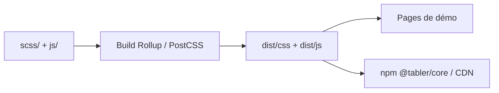

# tabler/tabler

> HTML UI kit for dashboards, built on Bootstrap 5, with more than 120 demo pages.

## The problem
Building a presentable admin dashboard takes time without ready-made components.

## What it actually does
Provides compiled CSS and JS (Bootstrap 5 included), Sass and TypeScript sources, dark mode and RTL versions, plus more than 20 plugins in `dist/libs` (charts, calendars, pickers). Tabler icons (6,000+) live in a neighboring project. Works with any framework (guides for React, Vue, Django, etc.).

## How it is wired


## Trying it
```bash
npm install @tabler/core
npx skills add tabler/tabler
```
```js
import '@tabler/core/dist/css/tabler.min.css'
import '@tabler/core/dist/js/tabler.min.js'
```

## Cost and gotchas
Free. The CDN snippet uses `@latest`: pin a version in production.

## What it is not
Not a data visualization tool: it provides the look and feel, not the queries or the business charts.

## Alternatives
No alternative named in the README.

## For you
Keep an eye on it: useful for quickly dressing up an internal dashboard; for Streamlit or Dash, it adds nothing.
