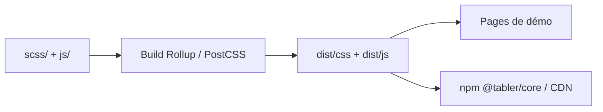

# tabler/tabler

> Kit d'interface HTML pour tableaux de bord, bâti sur Bootstrap 5, avec plus de 120 pages de démonstration.

## Le problème
Monter un tableau de bord d'administration présentable prend du temps sans composants prêts à l'emploi.

## Ce que ça fait vraiment
Fournit CSS et JS compilés (Bootstrap 5 inclus), sources Sass et TypeScript, mode sombre et versions RTL, plus de 20 plugins dans `dist/libs` (graphiques, calendriers, sélecteurs). Icônes Tabler (6 000+) en projet voisin. Compatible avec tout framework (guides React, Vue, Django, etc.).

## Comment c'est branché


## Essayer
```bash
npm install @tabler/core
npx skills add tabler/tabler
```
```js
import '@tabler/core/dist/css/tabler.min.css'
import '@tabler/core/dist/js/tabler.min.js'
```

## Coût et pièges
Gratuit. Le snippet CDN utilise `@latest` : épingle une version en production.

## Ce que ce n'est pas
Pas un outil de visualisation de données : il fournit l'habillage, pas les requêtes ni les graphiques métiers.

## Alternatives
Aucune alternative nommée dans le README.

## Pour toi
Surveiller : sert à habiller un tableau de bord interne rapidement ; pour Streamlit ou Dash, il n'apporte rien.

