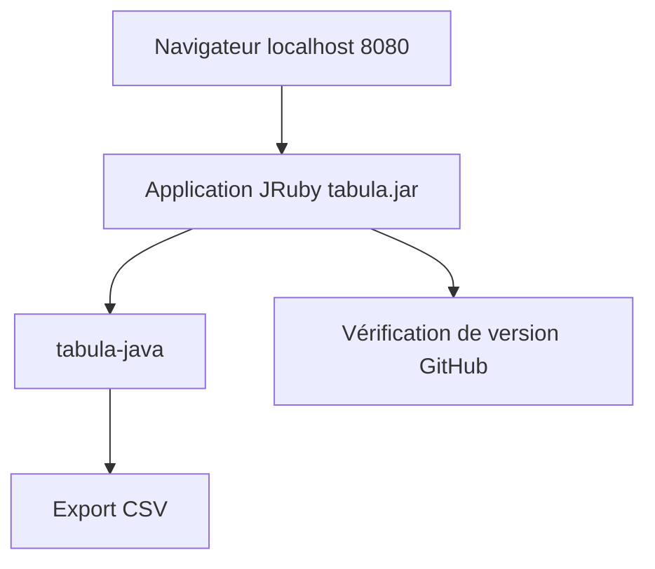

# tabulapdf/tabula

> Local application that extracts tables from text-based PDFs into CSV.

## The problem
Copy-pasting table rows out of a PDF gives a mess.

## What it actually does
A local web interface (port 8080) where you load a PDF, select the tables and export to CSV. The engine is the Java library tabula-java. Scanned PDFs are not supported. Available as a JAR, Windows and Mac executables, snap and Docker Compose.

## How it is wired

Diagram not provided: simplified diagram based on the README.

## Trying it
```bash
sudo snap install tabula
java -Dfile.encoding=utf-8 -Xms256M -Xmx1024M -jar tabula.jar
# interface sur http://127.0.0.1:8080/
```

## Cost and gotchas
Java required. Two network calls by default (version check, counter), which can be disabled with `-Dtabula.disable_version_check=1` and `-Dtabula.disable_notifications=1`.

## What it is not
No character recognition (OCR). The original authors no longer have time: the application will hardly receive any more updates.

## Alternatives
- tabula-java: library and CLI, still updated.
- tabula-py: Python bindings to automate it.
- tabulizer (R) and tabula-js (Node).

## For you
Worth watching: the application is frozen; for data work, prefer tabula-py or tabula-java to automate.
