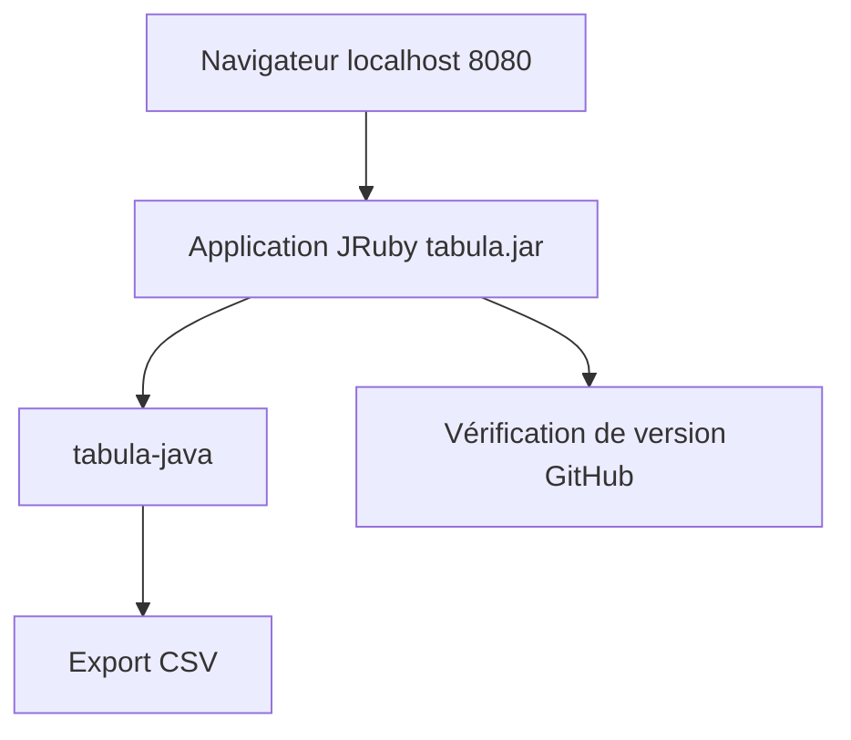

# tabulapdf/tabula

> Application locale qui extrait en CSV les tableaux contenus dans des PDF textuels.

## Le problème
Copier-coller des lignes de tableau depuis un PDF donne du désordre.

## Ce que ça fait vraiment
Une interface web locale (port 8080) où l'on charge un PDF, sélectionne les tableaux et exporte en CSV. Le moteur est la bibliothèque Java tabula-java. Les PDF scannés ne sont pas pris en charge. Existe en JAR, exécutables Windows et Mac, snap et Docker Compose.

## Comment c'est branché

Schéma non fourni : diagramme simplifié d'après le README.

## Essayer
```bash
sudo snap install tabula
java -Dfile.encoding=utf-8 -Xms256M -Xmx1024M -jar tabula.jar
# interface sur http://127.0.0.1:8080/
```

## Coût et pièges
Java requis. Deux appels réseau par défaut (version, compteur) désactivables avec `-Dtabula.disable_version_check=1` et `-Dtabula.disable_notifications=1`.

## Ce que ce n'est pas
Pas de reconnaissance de caractères. Les auteurs d'origine n'ont plus le temps : l'application ne recevra guère de mises à jour.

## Alternatives
- tabula-java : bibliothèque et CLI, toujours mise à jour.
- tabula-py : liaisons Python pour l'automatiser.
- tabulizer (R) et tabula-js (Node).

## Pour toi
À surveiller : l'application est figée ; en data, préférer tabula-py ou tabula-java pour automatiser.

