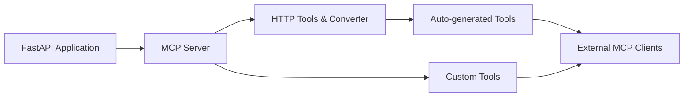

# tadata-org/fastapi_mcp

> FastAPI extension that automatically exposes your endpoints as MCP tools for AI agents.

## The problem
Making an existing API usable by an agent via MCP forces you to rewrite each endpoint as a tool.

## What it actually does
`FastApiMCP(app).mount()` publishes an MCP server at `/mcp` from the FastAPI routes.
Keeps request/response schemas and the Swagger documentation of the endpoints.
Authentication via the existing `Depends()` dependencies.
Direct ASGI transport to the app (no internal HTTP call); joint or separate deployment.

## How it is wired


## Trying it
```bash
uv add fastapi-mcp
pip install fastapi-mcp
```

## Cost and gotchas
Free, MIT; Python 3.10+. Optional paid hosted offer at tadata.com.
All your endpoints become tools: filter what is exposed to an agent.

## What it is not
Not a generic OpenAPI converter: works with a FastAPI app, not other frameworks.
Not an MCP client.

## Alternatives
No alternative named in the README.

## For you
Adopt: if your models are served with FastAPI, it is the shortest path to make them callable by an agent, with your existing auth.
