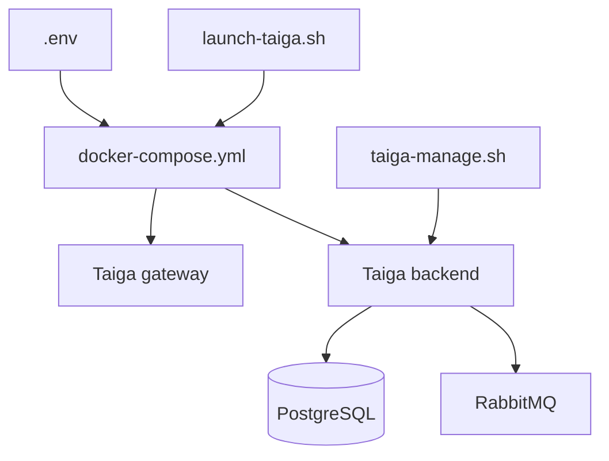

# taigaio/taiga-docker

> Docker Compose files to self-host the Taiga agile project management platform.

## The problem
Installing Taiga by hand means setting up the PostgreSQL database, the RabbitMQ queue, the backend, the front end and the gateway, then wiring them together.

## What it actually does
The repository does not contain Taiga's logic: it packages it. An `.env` file sets the database, URL, secret key, email, RabbitMQ and telemetry. `launch-taiga.sh` starts the stack; `taiga-manage.sh` runs manage.py commands, for example creating the superuser. Importers (GitHub, Jira, Trello) and GitHub/GitLab authentication are enabled via variables.

## How it is wired


## Trying it
```bash
./launch-taiga.sh
./taiga-manage.sh createsuperuser
```

## Cost and gotchas
Docker 19.03+ and an nginx proxy to configure for going online. The default values (`SECRET_KEY`, passwords) must be changed. Anonymous telemetry is enabled by default (`ENABLE_TELEMETRY=True`). Last push in October 2025.

## What it is not
It is not Taiga itself but its Docker deployment. The `stable` branch is for production, `main` for development. Public sign-up is disabled by default.

## Alternatives
No alternative named in the README.

## For you
Watch: a clean Taiga deployment if you want a self-hosted agile tool, but the repository has not moved in over a year and telemetry is on by default.
