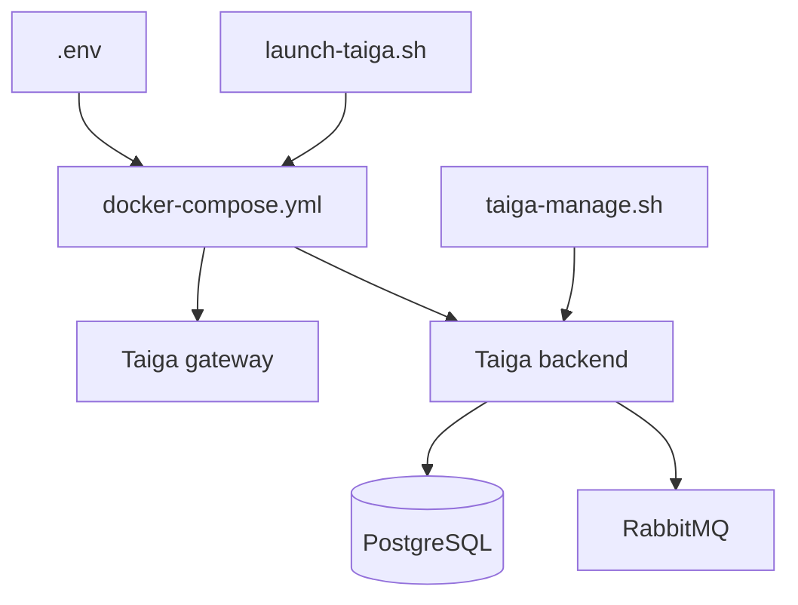

# taigaio/taiga-docker

> Fichiers Docker Compose pour auto-héberger la plateforme de gestion de projet agile Taiga.

## Le problème
Installer Taiga à la main impose de monter la base PostgreSQL, la file RabbitMQ, le backend, le front et la passerelle, puis de les raccorder.

## Ce que ça fait vraiment
Le dépôt ne contient pas la logique de Taiga : il l'empaquette. Un fichier `.env` règle base, URL, clé secrète, e-mail, RabbitMQ et télémétrie. `launch-taiga.sh` démarre la pile ; `taiga-manage.sh` lance les commandes manage.py, par exemple la création du superutilisateur. Des importeurs (GitHub, Jira, Trello) et l'authentification GitHub/GitLab s'activent par variables.

## Comment c'est branché


## Essayer
```bash
./launch-taiga.sh
./taiga-manage.sh createsuperuser
```

## Coût et pièges
Docker 19.03+ et un proxy nginx à configurer pour une mise en ligne. Les valeurs par défaut (`SECRET_KEY`, mots de passe) sont à changer. La télémétrie anonyme est activée par défaut (`ENABLE_TELEMETRY=True`). Dernier push en octobre 2025.

## Ce que ce n'est pas
Ce n'est pas Taiga lui-même mais son déploiement Docker. La branche `stable` sert à la production, `main` au développement. L'inscription publique est désactivée par défaut.

## Alternatives
Aucune alternative nommée dans le README.

## Pour toi
À surveiller : un déploiement propre de Taiga si tu veux un outil agile auto-hébergé, mais le dépôt n'a pas bougé depuis plus d'un an et la télémétrie est active par défaut.

