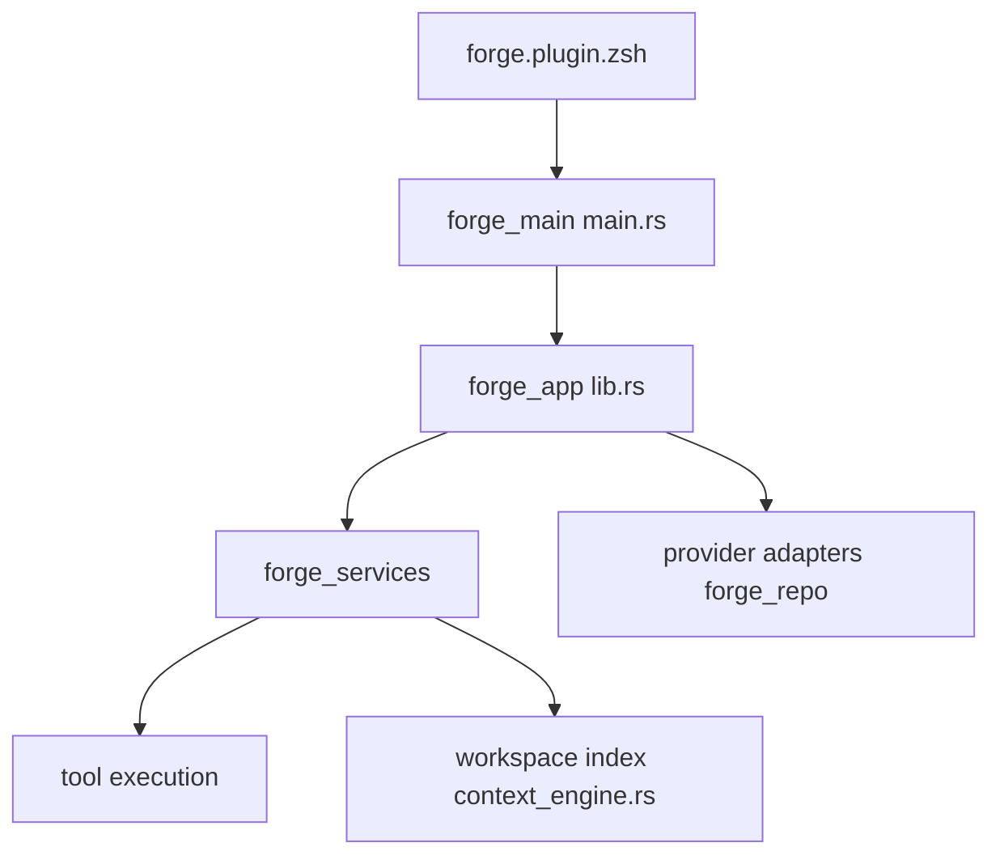

# tailcallhq/forgecode

> Terminal coding agent in Rust, with TUI, ZSH plugin, MCP and semantic search.

## The problem
Using an LLM to code forces you to leave the terminal, copy context and switch between providers.

## What it actually does
Rust monorepo: `forge_main` (CLI and TUI), `forge_app` (turn orchestration), `forge_services`, `forge_domain`, `forge_infra`, `forge_repo` (PostgreSQL persistence via Diesel), Anthropic, OpenAI, Google and Bedrock adapters. Tools: `fs_read`, `fs_patch`, `shell`, `net_fetch`, `semantic_search`. Local or remote MCP. ZSH plugin `:`.

## How it is wired


## Trying it
```bash
curl -fsSL https://forgecode.dev/cli | sh
forge provider login
forge
forge suggest "list files by size"
forge doctor
```

## Cost and gotchas
Free, but a provider API key is at your expense. `:sync` sends file contents to `https://api.forgecode.dev` by default. README truncated in the block.

## What it is not
Not a model. Same content as antinomyhq/forge and antinomyhq/forgecode: do not count it three times.

## Alternatives
No alternative named in the README.

## For you
Worth watching: clean, multi-provider Rust architecture, but remote indexing to be evaluated on private code.
