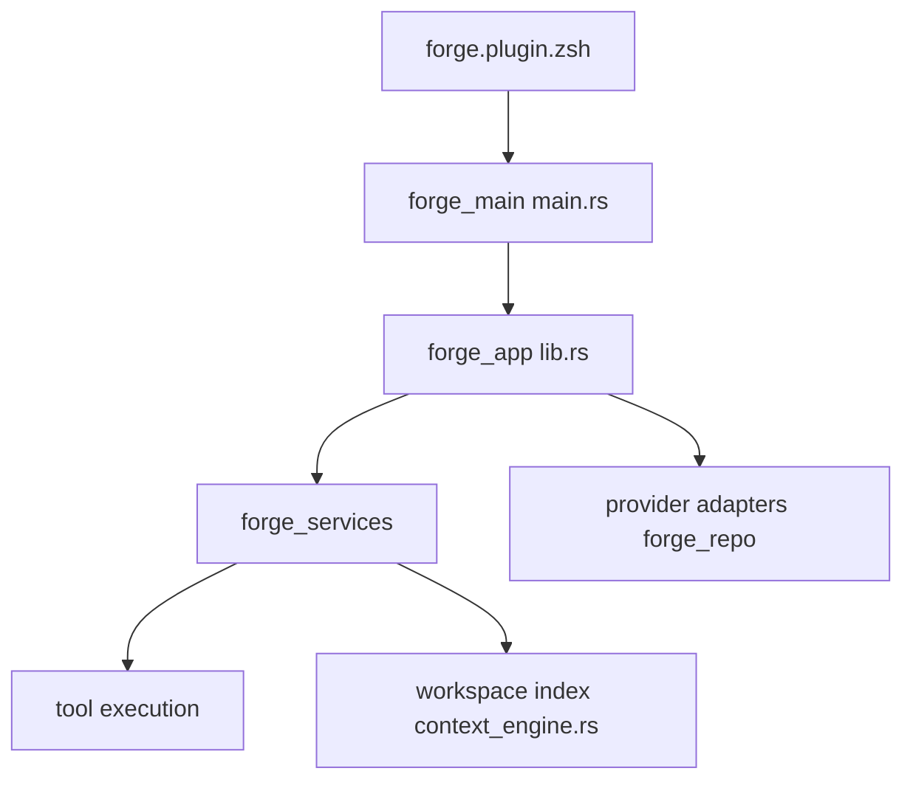

# tailcallhq/forgecode

> Agent de code en terminal en Rust, avec TUI, plugin ZSH, MCP et recherche sémantique.

## Le problème
Utiliser un LLM pour coder oblige à quitter le terminal, copier du contexte et basculer entre fournisseurs.

## Ce que ça fait vraiment
Monorepo Rust : `forge_main` (CLI et TUI), `forge_app` (orchestration des tours), `forge_services`, `forge_domain`, `forge_infra`, `forge_repo` (persistance PostgreSQL via Diesel), adaptateurs Anthropic, OpenAI, Google et Bedrock. Outils : `fs_read`, `fs_patch`, `shell`, `net_fetch`, `semantic_search`. MCP local ou distant. Plugin ZSH `:`.

## Comment c'est branché


## Essayer
```bash
curl -fsSL https://forgecode.dev/cli | sh
forge provider login
forge
forge suggest "list files by size"
forge doctor
```

## Coût et pièges
Gratuit, mais clé d'API d'un fournisseur à ta charge. `:sync` envoie le contenu des fichiers à `https://api.forgecode.dev` par défaut. README tronqué dans le bloc.

## Ce que ce n'est pas
Pas un modèle. Même contenu que antinomyhq/forge et antinomyhq/forgecode : à ne pas compter trois fois.

## Alternatives
Aucune alternative nommée dans le README.

## Pour toi
À surveiller : architecture Rust propre et multi-fournisseurs, mais indexation distante à évaluer sur du code privé.

