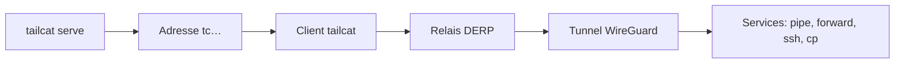

# tailscale/tailcat

> WireGuard-encrypted netcat, on Tailscale's data plane, with no account or control plane.

## The problem
Connecting two machines behind NATs, encrypted, without a VPN, root or Tailscale account.

## What it actually does
One side runs a server and gets a `tc…` address; the other connects to it. Traffic goes through a DERP relay, then directly via NAT traversal when possible. Services: stdin/stdout pipe, port forwarding, SSH, per-connection command, file transfer, SOCKS5, exit node. Go library and WebAssembly demo.

## How it is wired


## Trying it
```bash
tailcat
echo hello | tailcat tcXXXXXXXXX
tailcat serve 8080,8443
tailcat recv ~/inbox
tailcat cp report.pdf tcXXXXXXXXX:
```

## Cost and gotchas
Free; public relays are rate-limited, have no SLA and can be revoked. The address is a secret: `no-auth-ssh` gives a shell to anyone who knows it. No API stability guarantee.

## What it is not
Not a full VPN nor a Tailscale product: no routing or DNS changes.

## Alternatives
No alternative named in the README.

## For you
Watch: handy for passing a port or a file between machines (remote GPU, notebook), but young and with no promised stability.
