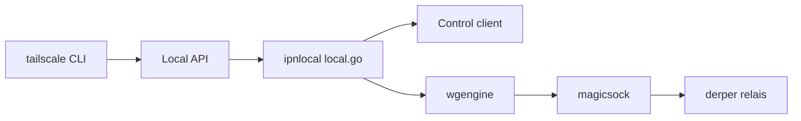

# tailscale/tailscale

> Open source client of Tailscale's WireGuard private network: the `tailscaled` daemon and the `tailscale` CLI.

## The problem
Link machines (workstations, GPU servers, containers) together securely, without opening ports or managing keys and NATs yourself.

## What it actually does
The `tailscaled` daemon registers with a hosted control service, receives the network map (peers, policies, DNS, routes), then configures the WireGuard engine. `magicsock` tries a direct UDP connection and falls back to DERP relays. The repository also contains the `derper` relay, a Kubernetes operator and optional services (SSH, file sharing).

## How it is wired


## Trying it
```bash
go install tailscale.com/cmd/tailscale{,d}
./build_dist.sh tailscale.com/cmd/tailscale
./build_dist.sh tailscale.com/cmd/tailscaled
```
Ready-to-install packages are served at https://pkgs.tailscale.com.

## Cost and gotchas
The client is free software, but the control service is hosted by Tailscale: an account is required, and the free tier has limits that the README does not detail. Go 1.27 to build. The macOS, iOS and Windows graphical interfaces are not open.

## What it is not
It is not a 100% standalone solution: the control plane stays with Tailscale. The repository does not include the graphical mobile apps. 4,622 open issues.

## Alternatives
No alternative named in the README.

## For you
Adopt it to link your machine, a GPU server and a cluster without exposing ports; accept the dependency on the hosted control service.
