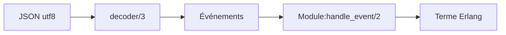

# talentdeficit/jsx

> Erlang library to read, produce and manipulate JSON, as a stream or in one block.

## The problem
Erlang has no simple path, in this README, between JSON text and Erlang terms, especially for incomplete input.

## What it actually does
`decode`, `encode`, `format`, `minify`, `prettify`, `is_json`, `is_term`. Tolerates comments, trailing commas, single quotes; `strict` mode to require the standard. Streaming decoding (`stream`) for partial input. Callback parser (`init/1`, `handle_event/2`). Inspired by yajl.

## How it is wired


## Trying it
```bash
rebar3 compile
rebar3 eunit
```
```erlang
jsx:decode(<<"{\"library\": \"jsx\", \"awesome\": true}">>, []).
```

## Cost and gotchas
Free. Last push in June 2024. Inputs must be utf8 binaries.

## What it is not
Not a strict validator by default: it is tolerant, you must enable `strict`.

## Alternatives
The README only names yajl, which inspired it.

## For you
Ignore: Erlang library, outside the data/AI stack.
