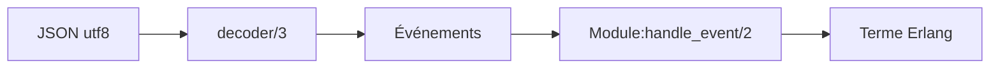

# talentdeficit/jsx

> Bibliothèque Erlang pour lire, produire et manipuler du JSON, en flux ou en bloc.

## Le problème
Erlang n'a pas, dans ce README, de chemin simple entre texte JSON et termes Erlang, surtout pour les entrées incomplètes.

## Ce que ça fait vraiment
`decode`, `encode`, `format`, `minify`, `prettify`, `is_json`, `is_term`. Tolère commentaires, virgule finale, guillemets simples ; mode `strict` pour exiger la norme. Décodage en flux (`stream`) pour entrées partielles. Parseur à callbacks (`init/1`, `handle_event/2`). Inspiré de yajl.

## Comment c'est branché


## Essayer
```bash
rebar3 compile
rebar3 eunit
```
```erlang
jsx:decode(<<"{\"library\": \"jsx\", \"awesome\": true}">>, []).
```

## Coût et pièges
Gratuit. Dernier push en juin 2024. Les entrées doivent être des binaires utf8.

## Ce que ce n'est pas
Pas un validateur strict par défaut : tolérant, il faut activer `strict`.

## Alternatives
Le README ne nomme que yajl, qui l'a inspiré.

## Pour toi
À ignorer : bibliothèque Erlang, hors stack data/IA.

