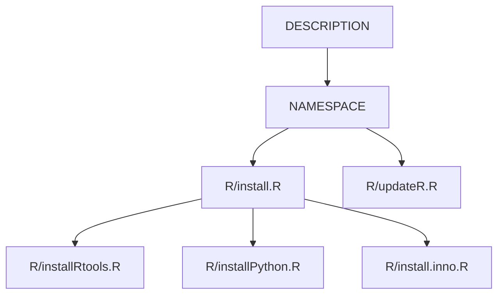

# talgalili/installr

> R package that updates R and installs development software on Windows.

## The problem
On Windows, installing or updating software means looking up the latest version, downloading it, running the installer, then deleting the file.

## What it actually does
R functions automate these steps: updateR updates R itself, installr opens a software selection interface (Git, RTools, MikTeX, pandoc…). Windows only, with a menu added to Rgui.

## How it is wired


## Trying it
```r
install.packages('installr')
library("installr")
updateR()
installr()
```

## Cost and gotchas
Free, Windows only. The repository is declared unsupported by its author. No license is declared in the catalog.

## What it is not
Not a cross-platform package manager, and no longer actively maintained.

## Alternatives
Winget and WingetUI: recommended by the author as a more general solution.

## For you
Ignore: the author himself declares it unsupported and points to Winget.
