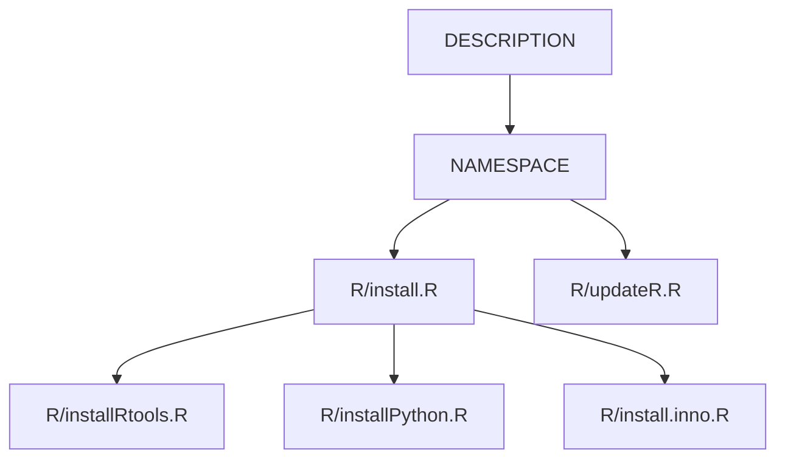

# talgalili/installr

> Package R qui met à jour R et installe les logiciels de développement sous Windows.

## Le problème
Sous Windows, installer ou mettre à jour un logiciel demande de chercher la dernière version, la télécharger, lancer l'installeur puis supprimer le fichier.

## Ce que ça fait vraiment
Des fonctions R automatisent ces étapes : updateR met à jour R lui-même, installr ouvre une interface de choix de logiciels (Git, RTools, MikTeX, pandoc…). Windows uniquement, avec un menu ajouté dans Rgui.

## Comment c'est branché


## Essayer
```r
install.packages('installr')
library("installr")
updateR()
installr()
```

## Coût et pièges
Gratuit, Windows seulement. Le dépôt est déclaré non supporté par son auteur. Aucune licence n'est déclarée dans le catalogue.

## Ce que ce n'est pas
Pas un gestionnaire de paquets multiplateforme, et plus maintenu activement.

## Alternatives
Winget et WingetUI : recommandés par l'auteur comme solution plus générale.

## Pour toi
À ignorer : l'auteur lui-même le déclare non supporté et renvoie vers Winget.

