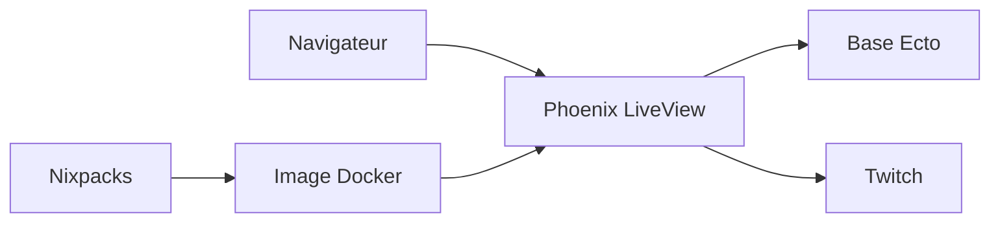

# talk2MeGooseman/stream_closed_captioner_phoenix

> Phoenix live-captioning application for Twitch broadcasters.

## The problem
Streamers want live captions, but the README does not describe the need.

## What it actually does
The README does not present features: it is a Phoenix getting-started guide. According to it, the application uses Ecto, a Node frontend and LiveView, Twitch variables (`TWITCH_TOKEN_SECRET`), and is deployed via Nixpacks and Coolify, or on Elastic Beanstalk.

## How it is wired
Simplified diagram based on the sheet, no diagram provided.



## Trying it
```bash
mix deps.get
mix ecto.setup
cd assets && npm install
mix phx.server
```

## Cost and gotchas
Elixir and a database are required, along with secrets (`SECRET_KEY_BASE`, `LIVE_SIGNING_SALT`, `TWITCH_TOKEN_SECRET`, `DATABASE_URL`). The environment variables section only says "Done through service".

## What it is not
It is not documented for third parties: no functional description. The GPL-3.0 license imposes copyleft.

## Alternatives
No alternative named in the README.

## For you
Ignore: a Twitch streaming application, unrelated to data / AI work, and the README has no functional description.
