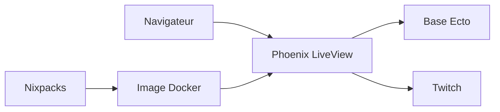

# talk2MeGooseman/stream_closed_captioner_phoenix

> Application Phoenix de sous-titrage en direct pour les diffuseurs Twitch.

## Le problème
Les streamers veulent des sous-titres en direct, mais le README ne décrit pas le besoin.

## Ce que ça fait vraiment
Le README ne présente pas les fonctions : c'est un guide de démarrage Phoenix. D'après lui, l'application utilise Ecto, un frontend Node et LiveView, des variables Twitch (`TWITCH_TOKEN_SECRET`), et se déploie via Nixpacks et Coolify, ou sur Elastic Beanstalk.

## Comment c'est branché
Schéma simplifié d'après la fiche, sans diagramme fourni.



## Essayer
```bash
mix deps.get
mix ecto.setup
cd assets && npm install
mix phx.server
```

## Coût et pièges
Elixir et une base de données sont nécessaires, ainsi que des secrets (`SECRET_KEY_BASE`, `LIVE_SIGNING_SALT`, `TWITCH_TOKEN_SECRET`, `DATABASE_URL`). La section sur les variables d'environnement dit seulement « Done through service ».

## Ce que ce n'est pas
Ce n'est pas documenté pour un tiers : aucune description fonctionnelle. La licence GPL-3.0 impose le copyleft.

## Alternatives
Aucune alternative nommée dans le README.

## Pour toi
À ignorer : application de streaming Twitch, sans lien avec un travail data / IA, et README sans description fonctionnelle.

