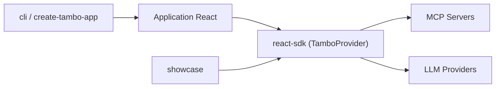

# tambo-ai/tambo

> React toolkit for agents that display generated interface components.

## The problem
A chatbot only returns text, while the user wants charts or interactive forms.

## What it actually does
You declare your React components with Zod schemas; these become tools for the model, which picks the component and streams the props. `@tambo-ai/react` SDK (TamboProvider, hooks), conversation and orchestration backend, MCP integration, local tools, context and suggestions. Persistent "interactable" components. Choice of models: OpenAI, Anthropic, Gemini, Mistral…

## How it is wired


## Trying it
```bash
npm create tambo-app my-tambo-app
cd my-tambo-app
npm run dev
```

## Cost and gotchas
The model provider's API key is at your expense. Tambo Cloud shuts down on October 31, 2026 (data deleted on November 30); you must self-host via SELF-HOSTING.md.

## What it is not
No longer a hosted service: the team is moving to another product (Charming). It remains open source MIT, but the repo's future is uncertain.

## Alternatives
- Vercel AI SDK: more manual to link tools and components.
- CopilotKit: multi-agent oriented.
- Assistant UI: chat-centered.

## For you
Only worth watching: the idea is good, but the cloud stops in four days; only adopt the self-hosted option.
