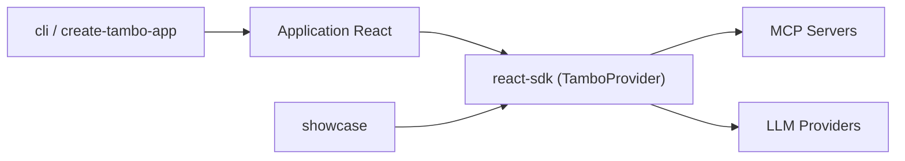

# tambo-ai/tambo

> Boîte à outils React pour agents qui affichent des composants d'interface générés.

## Le problème
Un chatbot ne renvoie que du texte, alors que l'utilisateur veut des graphiques ou des formulaires interactifs.

## Ce que ça fait vraiment
On déclare ses composants React avec des schémas Zod ; ceux-ci deviennent des outils pour le modèle, qui choisit le composant et diffuse les props. SDK `@tambo-ai/react` (TamboProvider, hooks), backend de conversation et d'orchestration, intégration MCP, outils locaux, contexte et suggestions. Composants « interactables » persistants. Modèles au choix : OpenAI, Anthropic, Gemini, Mistral…

## Comment c'est branché


## Essayer
```bash
npm create tambo-app my-tambo-app
cd my-tambo-app
npm run dev
```

## Coût et pièges
Clé d'API du fournisseur de modèle à ta charge. Tambo Cloud ferme le 31 octobre 2026 (données supprimées le 30 novembre) ; il faut auto-héberger via SELF-HOSTING.md.

## Ce que ce n'est pas
Plus un service hébergé : l'équipe passe à un autre produit (Charming). Reste open source MIT, mais l'avenir du dépôt est incertain.

## Alternatives
- Vercel AI SDK : plus manuel pour lier outils et composants.
- CopilotKit : orienté multi-agents.
- Assistant UI : centré sur le chat.

## Pour toi
À surveiller seulement : l'idée est bonne, mais le cloud s'arrête dans quatre jours ; n'adopte que l'option auto-hébergée.

