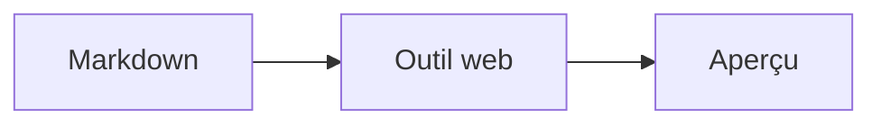

# tanabe/markdown-live-preview

> Small web tool to preview Markdown text.

## The problem
Seeing the Markdown rendering while writing.

## What it actually does
The README boils down to three commands: setup, build, local development. Nothing is said about features, dependencies or usage: undocumented.

## How it is wired

Minimal diagram, for lack of material.

## Trying it
```bash
make setup
make build
make dev
```

## Cost and gotchas
Free. Prerequisites undocumented.

## What it is not
Not a documented editor: the README does not say what it supports.

## Alternatives
The README names no alternative.

## For you
Ignore: too little documentation and covered by any editor or VS Code.
