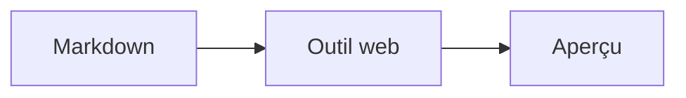

# tanabe/markdown-live-preview

> Petit outil web pour prévisualiser du texte Markdown.

## Le problème
Voir le rendu Markdown pendant l'écriture.

## Ce que ça fait vraiment
Le README tient en trois commandes : setup, build, développement local. Rien n'est dit des fonctionnalités, dépendances ou usage : non documenté.

## Comment c'est branché

Schéma minimal, faute de matière.

## Essayer
```bash
make setup
make build
make dev
```

## Coût et pièges
Gratuit. Prérequis non documentés.

## Ce que ce n'est pas
Pas un éditeur documenté : le README ne dit pas ce qu'il supporte.

## Alternatives
Le README ne nomme pas d'alternative.

## Pour toi
À ignorer : trop peu documenté et couvert par n'importe quel éditeur ou VS Code.

