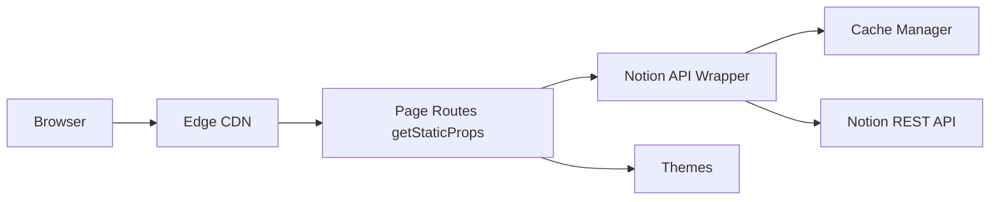

# tangly1024/NotionNext

> Site generator (blog, docs, portfolio) that publishes Notion pages via Next.js on Vercel.

## The problem
Publishing a blog or a knowledge base without leaving Notion, without setting up a CMS yourself.

## What it actually does
A Next.js site reads Notion pages through the API (wrapper in lib/notion), pre-renders them with SSG/ISR and serves them from Vercel. A three-level cache (memory, local file, Redis) avoids calling Notion again. 26 built-in themes, comments (Twikoo, Giscus…), Algolia search, analytics.

## How it is wired


## Trying it
```bash
nvm use || nvm install
npm i -g yarn
yarn
yarn dev
```

## Cost and gotchas
Notion account and Vercel account required. Node 22 required (Node 20 no longer installs). README mostly in Chinese.

## What it is not
Not a data/AI tool. The README says "free, personal and legal use" with no license declared in the catalog: reuse to be checked.

## Alternatives
- Nobelium: the project NotionNext is derived from (acknowledgments).
- Elog: Markdown export from Notion to Hexo, VitePress, WordPress.

## For you
Off-topic for a data/AI/MLOps profile: it is a blog generator, useful only if you want to publish your notes from Notion.
