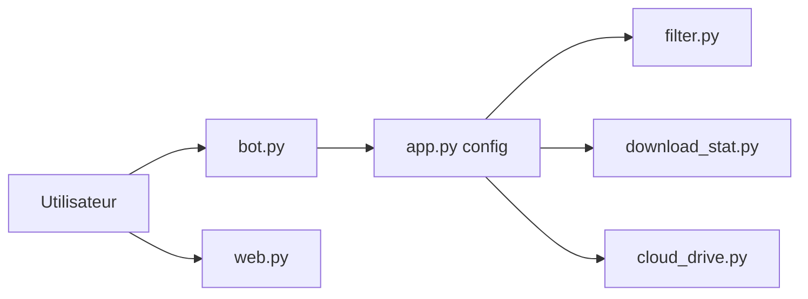

# tangyoha/telegram_media_downloader

> Downloads media from Telegram channels and groups, with a command bot and a web interface.

## The problem
Manually fetching photos, videos and documents in bulk from a Telegram channel is tedious.

## What it actually does
Two modes: Telegram bot (`download` and `forward` commands) or one-off download. YAML configuration: chats, date filters, media types and formats, file tree layout, up to 5 parallel tasks. Web interface on port 5000, optional upload to a cloud via rclone or aligo, socks/http proxy.

## How it is wired


## Trying it
```bash
git clone https://github.com/tangyoha/telegram_media_downloader.git
cd telegram_media_downloader
make install
python3 media_downloader.py
```

## Cost and gotchas
Free, but you need a Telegram `api_id`/`api_hash` pair and phone-number login on first launch. Automating a Telegram account may be restricted by the platform (not specified in the README).

## What it is not
Not a legal archiving tool nor a structured-data scraper: it copies media files.

## Alternatives
No alternative named in the README.

## For you
Ignore: except for an occasional need to collect media for a dataset, nothing in the repository concerns data/AI/MLOps.
