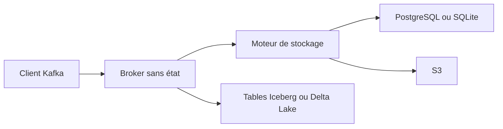

# tansu-io/tansu

> A stateless broker that speaks the Kafka protocol and stores messages in PostgreSQL, SQLite or S3.

## The problem
Running a Kafka cluster for small streams is expensive to operate. Applications, for their part, just want a Kafka client that answers.

## What it actually does
A single binary implements the Kafka API (protocol generated from Kafka 3.9.1). Brokers keep nothing: topics, messages and consumer groups live in the storage engine (PostgreSQL, libSQL, S3, memory). Topics validated by JSON Schema, Avro or Protobuf can be written to Iceberg or Delta Lake tables. Kafka transactions are not supported.

## How it is wired
Simplified diagram based on the sheet, no diagram provided.



## Trying it
The README points to the docs for commands (prebuilt binary, Docker Compose or cargo). No installation command is given in the README itself.

```bash
# non documenté dans le README : voir « Get Started with Nisshi » dans la doc
```

## Cost and gotchas
Free, Apache 2.0 license, provided without warranty or Solace support. The `topic`, `cat` and `perf` commands connect in clear text without TLS and SASL options.

## What it is not
Not a full Kafka: transactions are not supported, so Kafka Streams in `exactly_once_v2` fails. The `proxy` command is not meant for production.

## Alternatives
- Apache Kafka: preferable if you need transactions and the whole official ecosystem.

## For you
Worth watching: the idea of a clusterless Kafka plugged into Postgres or S3, with output to Iceberg tables, can lighten a data platform, but the compatibility gaps call for a test with your clients.
