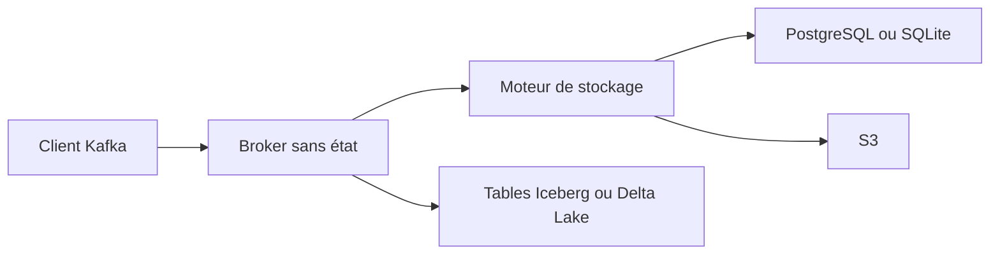

# tansu-io/tansu

> Un broker sans état qui parle le protocole Kafka et range les messages dans PostgreSQL, SQLite ou S3.

## Le problème
Faire tourner un cluster Kafka pour de petits flux coûte cher en exploitation. Les applications, elles, veulent juste un client Kafka qui répond.

## Ce que ça fait vraiment
Un binaire unique implémente l'API Kafka (protocole généré depuis Kafka 3.9.1). Les brokers ne gardent rien : topics, messages et groupes de consommateurs vivent dans le moteur de stockage (PostgreSQL, libSQL, S3, mémoire). Les topics validés par JSON Schema, Avro ou Protobuf peuvent être écrits en tables Iceberg ou Delta Lake. Les transactions Kafka ne sont pas gérées.

## Comment c'est branché
Schéma simplifié d'après la fiche, sans diagramme fourni.



## Essayer
Le README renvoie à la doc pour les commandes (binaire précompilé, Docker Compose ou cargo). Aucune commande d'installation n'est donnée dans le README lui-même.

```bash
# non documenté dans le README : voir « Get Started with Nisshi » dans la doc
```

## Coût et pièges
Gratuit, licence Apache 2.0, fourni sans garantie ni support Solace. Les commandes `topic`, `cat`, `perf` se connectent en clair sans options TLS et SASL.

## Ce que ce n'est pas
Pas un Kafka complet : les transactions ne sont pas supportées, donc Kafka Streams en `exactly_once_v2` échoue. La commande `proxy` n'est pas prévue pour la production.

## Alternatives
- Apache Kafka : à préférer si tu as besoin des transactions et de tout l'écosystème officiel.

## Pour toi
À surveiller : l'idée d'un Kafka sans cluster branché sur Postgres ou S3, avec sortie en tables Iceberg, peut alléger une plateforme de données, mais les lacunes de compatibilité demandent un test sur tes clients.

