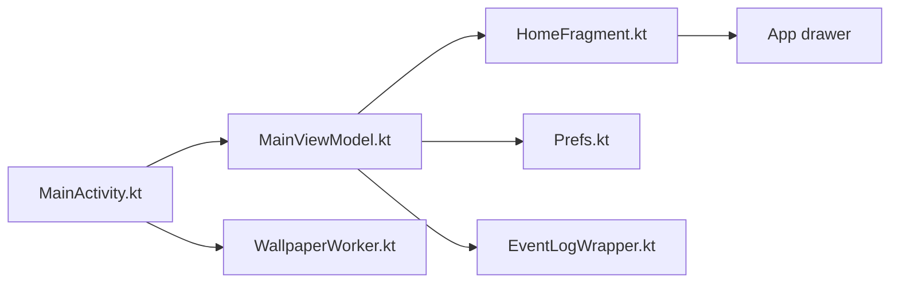

# tanujnotes/Olauncher

> Minimalist, ad-free Android launcher, for those who want fewer icons and fewer distractions.

## The problem
Android home screens are loaded with icons, ads and distractions.

## What it actually does
A clean home screen with shortcuts, app drawer, swipe gestures, settings, usage statistics (screen time), daily wallpaper change, an accessibility service to lock the screen. A few features are hidden and listed in the About page.

## How it is wired

## Trying it
No command: install via Play Store, F-Droid, IzzyOnDroid or APK.

## Cost and gotchas
Free. A Pro version (widgets, weather, folders) exists separately, according to the README.

## What it is not
Not a feature-rich launcher: widgets and folders are in the Pro version. Not a data tool.

## Alternatives
Pro Launcher and Supernova (same team, cited in the README): more features.

## For you
Ignore: an Android launcher unrelated to data/AI/MLOps; a matter of personal taste.
