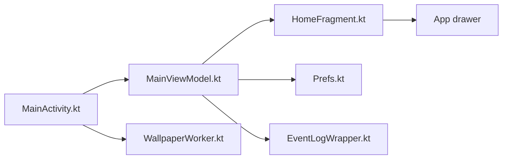

# tanujnotes/Olauncher

> Lanceur Android minimaliste et sans publicité, pour qui veut moins d'icônes et moins de distractions.

## Le problème
Les écrans d'accueil Android sont chargés d'icônes, publicités et distractions.

## Ce que ça fait vraiment
Écran d'accueil épuré avec raccourcis, tiroir d'applications, gestes de balayage, réglages, statistiques d'usage (écran), changement de fond d'écran quotidien, service d'accessibilité pour verrouiller l'écran. Quelques fonctions sont cachées et listées dans la page À propos.

## Comment c'est branché

## Essayer
Aucune commande : installation via Play Store, F-Droid, IzzyOnDroid ou APK.

## Coût et pièges
Gratuit. Une version Pro (widgets, météo, dossiers) existe à part, d'après le README.

## Ce que ce n'est pas
Pas un lanceur riche en fonctions : widgets et dossiers sont dans la version Pro. Pas un outil data.

## Alternatives
Pro Launcher et Supernova (même équipe, cités dans le README) : plus de fonctions.

## Pour toi
Ignorer : lanceur Android sans lien avec data/IA/MLOps ; affaire de goût personnel.

