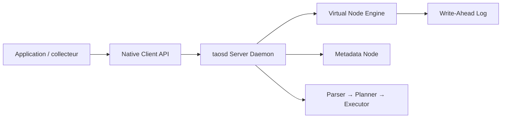

# taosdata/TDengine

> Distributed time-series database for IoT and industry, with the TDgpt AI agent.

## The problem
Ingesting and querying billions of sensor points with high cardinality and reasonable operating cost.

## What it actually does
Distributed database with node roles (mnode, vnode, qnode, snode), SQL, caching, streaming, subscriptions, Raft replication and super-tables. TDgpt connects foundation models or LLMs for forecasting, anomaly detection, imputation and classification. The repository README mostly describes the build, tests and packaging.

## How it is wired


## Trying it
```bash
git clone https://github.com/taosdata/TDengine.git
cd TDengine
mkdir debug && cd debug
cmake .. -DBUILD_CONTRIB=ON
make -j$(nproc)
```

## Cost and gotchas
First build with `-DBUILD_CONTRIB=ON` is mandatory; Linux first (Windows limited). Connectors, taosx and explorer are outside this repository. S3 disabled in the community edition.

## What it is not
Not a general-purpose analytical warehouse. AGPL-3.0, with a commercial Cloud offering alongside.

## Alternatives
No alternative named in the README.

## For you
Interesting for massive IoT time series with built-in forecasting; check the impact of the AGPL.
