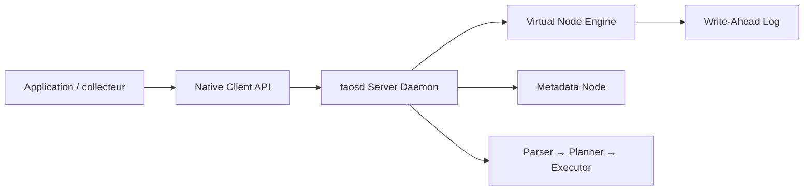

# taosdata/TDengine

> Base de séries temporelles distribuée pour l'IoT et l'industrie, avec agent IA TDgpt.

## Le problème
Ingérer et interroger des milliards de points de capteurs avec cardinalité élevée et coût d'exploitation raisonnable.

## Ce que ça fait vraiment
Base distribuée avec rôles de nœuds (mnode, vnode, qnode, snode), SQL, cache, streaming, souscriptions, réplication Raft et super-tables. TDgpt connecte des modèles de fondation ou LLM pour prévision, détection d'anomalies, imputation et classification. Le README du dépôt décrit surtout le build, les tests et le packaging.

## Comment c'est branché


## Essayer
```bash
git clone https://github.com/taosdata/TDengine.git
cd TDengine
mkdir debug && cd debug
cmake .. -DBUILD_CONTRIB=ON
make -j$(nproc)
```

## Coût et pièges
Premier build avec `-DBUILD_CONTRIB=ON` obligatoire ; Linux prioritaire (Windows limité). Les connecteurs, taosx et explorer sont hors de ce dépôt. S3 désactivé en édition communautaire.

## Ce que ce n'est pas
Pas un entrepôt analytique généraliste. AGPL-3.0, avec offre Cloud commerciale en parallèle.

## Alternatives
Aucune alternative nommée dans le README.

## Pour toi
Intéressant pour des séries temporelles IoT massives avec prévision intégrée ; vérifie l'impact de l'AGPL.

