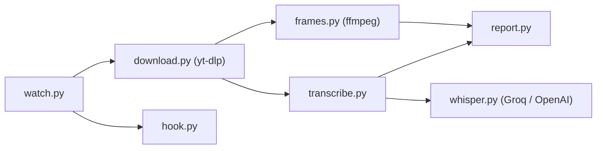

# taoufik123-collab/claude-watch

> /watch skill that gives Claude video frames, a transcript and an analysis of the first ten seconds.

## The problem
Claude cannot watch a video: a YouTube link gives only the title or a transcript without the image.

## What it actually does
`watch.py` downloads via yt-dlp, extracts ffmpeg frames (one per scene change, budget capped at 100 frames and 2 fps), fetches the subtitles or falls back to Whisper (Groq or OpenAI). `hook.py` analyzes the first 10 seconds at 2 fps. `report.py` produces a `report.md` with areas for Claude to fill in; optional saving into Obsidian. Built on the claude-video project.

## How it is wired


## Trying it
```bash
/plugin marketplace add taoufik123-collab/claude-watch
/plugin install watch@claude-watch
git clone https://github.com/taoufik123-collab/claude-watch.git ~/.codex/skills/watch
```

## Cost and gotchas
yt-dlp and ffmpeg are installed on first launch (brew on macOS). A Groq or OpenAI key only when there are no subtitles. The frames quickly consume context; mostly effective under 10 minutes.

## What it is not
No access to private platforms (no login). Not a deep-understanding tool: Claude "sees" sampled images.

## Alternatives
No alternative cited; the README says the foundation comes from the `claude-video` project.

## For you
Ignore if you already have a `watch` skill installed: the only novelty is scene-based extraction and opening analysis, geared toward content creation.
