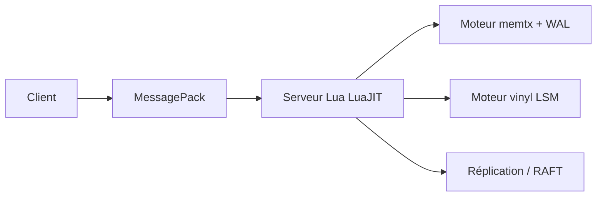

# tarantool/tarantool

> In-memory database coupled with a Lua application server, for queues, caches and stateful apps.

## The problem
A cache or queue separate from the application logic adds network round trips and components to operate.

## What it actually does
A Lua server (LuaJIT) with cooperative multitasking embeds a database: in-memory engine with WAL, or LSM-tree for large volumes. HASH, TREE, RTREE, BITSET indexes, ANSI SQL, asynchronous or synchronous replication, RAFT-style leader election. The protocol is based on MessagePack. The database is a C extension of the server and can be disabled.

## How it is wired

Engine names not specified in the README: simplified diagram.

## Trying it
```bash
# Aucune commande dans le README : renvoie vers la page de téléchargement
# (paquet binaire ou Docker) et la doc de compilation depuis les sources.
```

## Cost and gotchas
Free. Platforms: Linux (x86_64, aarch64), macOS (x86_64, M1), FreeBSD x86_64. No Windows. RAM determines the data size of the in-memory engine.

## What it is not
Not a simple Redis-like cache: you need to write Lua to make use of the application server. The README states BSD 2-Clause but GitHub does not identify the license: to be checked. 1,764 open issues.

## Alternatives
The README names no alternative.

## For you
Worth watching: interesting for low-latency stateful workloads, but Lua and the dedicated ecosystem (vshard, cartridge) are an unusual investment in data/AI.
