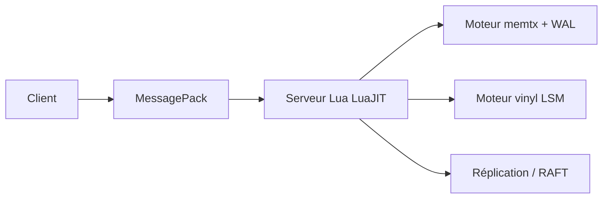

# tarantool/tarantool

> Base de données en mémoire couplée à un serveur d'applications Lua, pour files d'attente, caches et applis à état.

## Le problème
Un cache ou une file d'attente séparés de la logique applicative ajoutent des allers-retours réseau et des composants à opérer.

## Ce que ça fait vraiment
Un serveur Lua (LuaJIT) avec multitâche coopératif embarque une base : moteur mémoire avec WAL, ou LSM-tree pour gros volumes. Index HASH, TREE, RTREE, BITSET, SQL ANSI, réplication asynchrone ou synchrone, élection de leader type RAFT. Le protocole est basé sur MessagePack. La base est une extension C du serveur et peut être désactivée.

## Comment c'est branché

Noms de moteurs non précisés dans le README : schéma simplifié.

## Essayer
```bash
# Aucune commande dans le README : renvoie vers la page de téléchargement
# (paquet binaire ou Docker) et la doc de compilation depuis les sources.
```

## Coût et pièges
Gratuit. Plateformes : Linux (x86_64, aarch64), macOS (x86_64, M1), FreeBSD x86_64. Pas de Windows. La mémoire vive conditionne la taille des données du moteur mémoire.

## Ce que ce n'est pas
Pas un simple cache Redis : il faut écrire du Lua pour exploiter le serveur d'applications. Le README annonce BSD 2-Clause mais GitHub n'identifie pas la licence : à vérifier. 1 764 issues ouvertes.

## Alternatives
Le README ne nomme pas d'alternative.

## Pour toi
À surveiller : intéressant pour du stateful à faible latence, mais le Lua et l'écosystème propre (vshard, cartridge) sont un investissement peu courant en data/IA.

